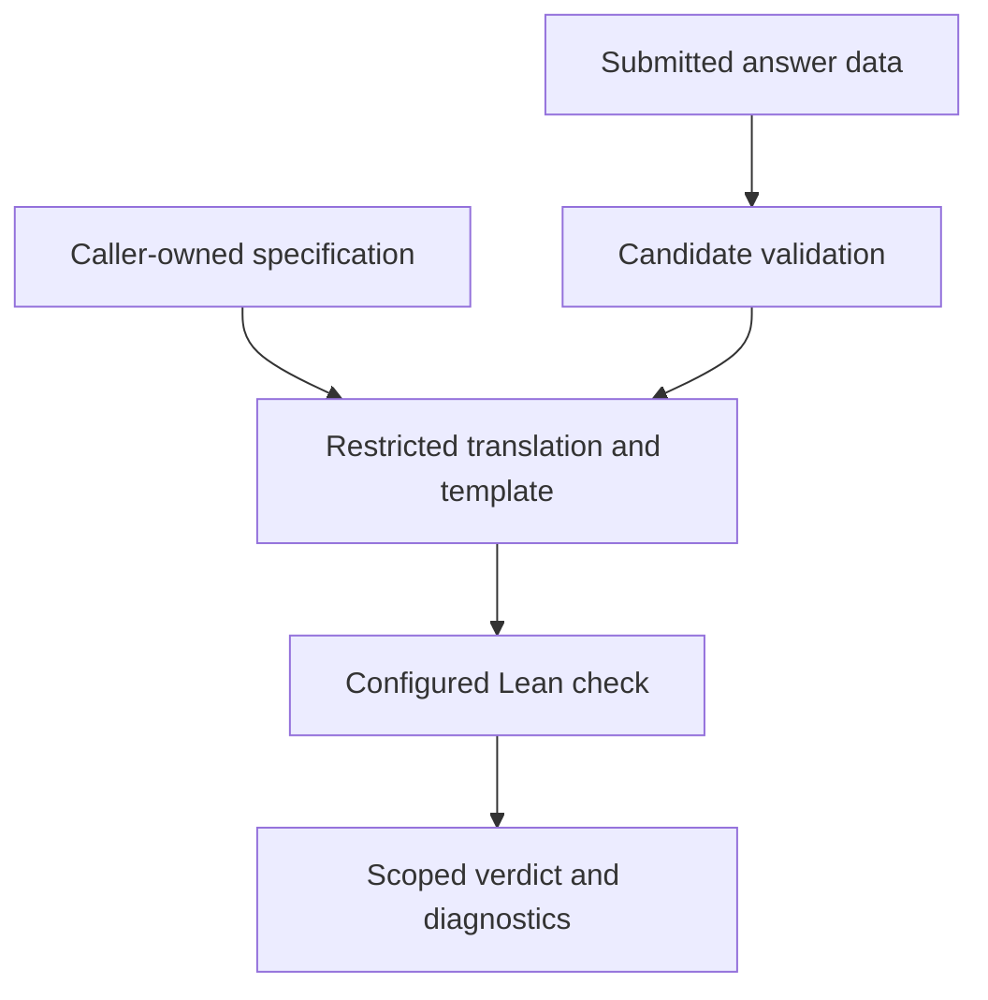

# Building a Lean-Backed Verifier for Bounded Mathematical Answers

The MathCheck Engine can check the correctness of a submitted answer against a finite specification. It does this by generating a Lean proposition and checking it using `native_decide`, under the trust assumptions of native Lean execution.

For instance, given the question "How many integers between 1 and 99 (inclusive) are divisible by 3?", how might an auto-grader determine if a submitted answer, say 33, is correct?

One way would be to compare the answer to a hard-coded correct value, also 33 in this case. This, however, requires one to know the answer ahead of time, and has some other downsides.

Another, more flexible way would be to write a specification for a correct answer - in this case, perhaps, "A correct answer is one which counts the number of elements in the interval that are 0 modulo 3". Then, a checker can be written to check answers against this specification.

MathCheck Engine provides a few interfaces (for exact evaluation, sum/count within bounds, minimum value and complete relations between pairs of integers), which take in a specification from the user, as well as the data to be checked (in this case, provided by an LLM), and use Lean to verify the proposition that the data is a correct answer against the specification.

Here are some of the interesting ideas involved in implementing this approach.

## Instead of specifying what the answer should be, specify a property the answer must satisfy

Here's how the above question would be encoded for MathCheck Engine:

```python
from lean_kernel_verifier.specification import ProblemSpec

spec = ProblemSpec(kind="count", expression="x%3 == 0", start=1, stop=100)
```

Note that intervals are half-open, so this denotes the interval [1, 100). The answer a will be accepted if and only if

$$
a = |\{x \in \mathbb{Z} : 1 \le x < 100 \land x \bmod 3 = 0\}|,
$$

which is exactly the number of multiples of 3 in the given interval. Crucially, notice that spec does not contain any information about what the expected answer should be - only a description of what a correct answer should look like. The checker will enumerate this entire domain to verify the answer.

But is it really without an answer key? Is it really without computation? Is it really without supervision? In fact, in this case, to check the answer, it does roughly the same amount of work as it would to compute the answer in the first place. And when it comes to choosing the correct rule and bounds, this is certainly supervised! So in a way, it’s almost the same, but the thing that must be trusted has changed from the answer to the specification.

There are more interesting use cases for this approach, though, when checking the answer is more interesting than just checking it against some scalar.

## Feasible is not necessarily least

Let’s try another task:

Find the least number in the range [0, 100) that satisfies x≡3(mod 7) and x≡2(mod 5).

In this case, there are three numbers that satisfy the congruences, 17, 52 and 87. Simply checking that the congruences are satisfied by the answer is not sufficient. Where did the new information come in? It came in from the word “least”. To check that some number a is the correct answer, one must show that

$$
0 \le a < 100 \land P(a) \land
\forall x \in \mathbb{Z} \cap [0,100),\; x<a \Rightarrow \neg P(x).
$$

where P(x) is the proposition that x satisfies the congruences. All three of these clauses are checked by the minimum contract in the Engine, which one would use to specify this problem as follows:

```python
spec = ProblemSpec("minimum", "x%7 == 3 and x%5 == 2", 0, 100)
```

If a backend is healthy, it should accept 17 as an answer to this problem but reject 52, since 17 is a smaller satisfying value. It should also reject values outside of the specified range, for mathematical reasons, not because the runtime has seen an example like this before.

Note that the finiteness of the range is part of the problem statement; it’s not an arbitrary choice. It’s true that the problem would be different if the range were not bounded, and in that case it would be up to the problem statement to show that the range is bounded. Simply putting a bound in to make the problem easier changes the question.

Another thing to note is that if the problem were specified with a predicate P(x) that was never satisfied, then there would be no integer that could be a successful submission, with the current specification.

## Follow the spec and check it in Lean



The structured path enforces a separation of concerns.

The model can’t, for example, replace the predicate, tweak the bounds, or pass an easier problem to the theorem prover, because the APIs are structured to generate the corresponding Lean source.

Moreover, while the Lean API does use Python’s expression parser, it only translates a restricted set of syntax trees into Lean code – there is no arbitrary eval-ing. It supports integer literals, declared variables, most arithmetic and comparison operations, and Boolean connectives, but it will raise an error if it encounters a function call, import, attribute, arbitrary identifier, or float, for instance. Division and modulo by a non-literal are also disallowed, to prevent division by zero (but division/modulo by a positive literal is allowed).

For the earlier count problem, `compile_answer_check` generates the following checking core (with added whitespace for legibility). The [complete file](https://github.com/stanleyngugi/mathcheck-engine/blob/main/examples/generated_count.lean), including a template with common options and definitions for arithmetic, can be found there.

```lean
def problem_spec (ans : Nat) : Bool := decide (
  ((List.range 99).filter (fun i =>
    let x := i + 1;
    decide ((((Int.ofNat x) % (3 : Int)) = (0 : Int)))
  )).length = ans
)

def f (_n : Nat) : Nat := if problem_spec 33 then 1 else 0

def expected : Array Nat := #[1]

theorem verify :
  (Array.range expected.size).all (fun n => f n == expected[n]!) = true := by
  native_decide
```

In Lean, Nat is the type of nonnegative integers, Int is the type of signed integers, and Bool is the type of computable booleans. decide is a function that takes a decidable proposition and tests it. In English, the above code says

Construct the list of integers from 0 to 98 (inclusive), add 1 to each element (to get the desired range of 1 to 99),

filter for those which satisfy the given predicate, get the length of the list, and compare it to the answer.

Define f to return 1 if and only if the candidate answer 33 passes the check from 2.

Require that f returns 1 via a theorem statement, and prove this theorem by evaluating the underlying decidable proposition with native_decide .

Some of the time you will see an array like `#[1]` in a template. This is just a way to mark that a template was successfully used. The answer 33 isn't stored in the shared template; it is inserted into the generated check for this submission. The same template is used to check any scalar or pair contract answer. When checking a finite sequence, the same template is still used, but it's used slightly differently and you need to provide the observations.

You can inspect the source for these without installing lean by importing the relevant function:

```python
from lean_kernel_verifier.specification import compile_answer_check

print(compile_answer_check(ProblemSpec("count", "x%3 == 0", 1, 100), 33))
```

To execute them, you'll need to configure a runner. Follow the [isolated-runner instructions](https://github.com/stanleyngugi/mathcheck-engine/blob/main/README.md#opt-in-linux-isolation), then set the `LEAN_BIN` env var to point to the installed `lean-isolated` launcher:

```python
import os
from lean_kernel_verifier.runner.checker_runner import CheckerRunConfig, LeanCheckerRunner
from lean_kernel_verifier.specification import verify_answer

runner = LeanCheckerRunner(CheckerRunConfig(
    lean_executable=os.environ["LEAN_BIN"],
    required_lean_version=(4, 23, 0),
    timeout_seconds=210,
))
try:
    result = verify_answer(ProblemSpec("count", "x%3 == 0", 1, 100), 33, runner)
    print(result.status, result.scope)
finally:
    runner.close()
```

The result object contains all the information you need: the candidate answer, the problem specification digest, the verification status and scope, whether you should trust the statement, and diagnostics from the checker. If execution of the answer checker fails for some reason, inspect the status field for more information.

## Valid, but not the whole relation

For another task, consider the relation

```text
x < y and x + y = 4
```

whose full answer over the domain [0, 5) x [0, 5) is [(0, 4), (1, 3)]. If you provide the pair (0, 4) as your answer, note that it satisfies the relation but it's not the whole answer. How do you check this?

```python
from lean_kernel_verifier.certificates import PairCountSpec, PairCertificate

spec = PairCountSpec("x < y and x+y == 4", 0, 5, 0, 5)
certificate = PairCertificate(((0, 4), (1, 3)), answer=2)
```

When you call `verify_pair_certificate(spec, certificate, runner)`, Lean will construct the full answer (in lexicographic domain order) and check that it exactly matches the list you provided, and that your provided answer matches the length of the list.

|Submission|Why it fails or succeeds|
|---|---|
|Both pairs, count 2|Complete relation and correct cardinality|
|Only `(0, 4)`, count 1|Valid witness, incomplete relation|
|Both pairs, count 1|Complete relation, wrong cardinality|
|A list containing `(2, 2)`|Contains a pair that does not satisfy the relation|
|A list that is unsorted or contains repeated pairs|Violates the required sorted, duplicate-free format|

Here ‘certificate’ means the entirety of the data of the answer, not necessarily something that is shorter or is verified with an algorithm that’s faster than one that simply re-computes the answer.

The actual check establishes that every listed pair satisfies the criteria and that no valid pair is omitted, by checking the lists are equal.

## Operational failure with a large answer

When the answers become large, it becomes a problem to represent the lists of pairs directly in the source representation in the form of a large Lean list. Although the domain size is bounded in this problem, it is still expensive to construct and elaborate such a representation.

The original sweep of this problem (which includes a sweep of sums, counts and pairs at different domain sizes, with 2 repetitions and both positive and negative controls, for a total of 48 trials) failed to complete all control trials. In particular, the four trials corresponding to the largest pair size timed out, and the other 44 controls completed.

The problem was addressed by changing the data representation. Pairs are now serialized in the form of bounded decimal numbers, for example:

```text
0,4;1,3
```

There is a Lean function that can interpret this representation as a list of pairs (returning an option type). The actual acceptance condition is now that the data is valid (i.e., its interpretation is not `none`), the interpreted data is equal to the correct relation (computed independently) and that the cardinality is correct (to avoid an issue where the interpretation could silently fail and produce an empty list).

The [revised set of trials](https://github.com/stanleyngugi/mathcheck-engine/blob/main/evaluation_records/public_v1_computational_sweep_fixed.jsonl) completes all 48 control trials as expected without operational failure. The [original set of trials](https://github.com/stanleyngugi/mathcheck-engine/blob/main/evaluation_records/public_v1_computational_sweep.jsonl), with the four timeout failures, can be seen there.

These are only historical, not a validation run for 0.3.3, and not under control for speedup, but the records will serve to show that the controls that previously failed do complete with the representation revised in this commit. Also note that repetitions are not under control for operating system cache effects.

The importance of representation for even bounded mathematical computation.

## Why not do this in python?

All of the acceptance relations currently used could be done in python (exhaustive counts, leastness, complete list equality, etc…) so why would it be necessary to use Lean to remove the answer key?

Short answer: Because it’s cool! Longer answer: Lean provides a formal language and framework for proving that what the checker does, does what it should. This doesn’t mean that what’s done here is better or even as good as it could be done in, say, python.

Another longer answer: one could write a proof checker or solver in python (or indeed any turing-complete language). Even better, one can (at least for a subset of python) formally verify that a python program meets contracts (see for example, [Nagini](https://www.pm.inf.ethz.ch/research/nagini.html)). SMT solvers and proof assistants have different roles and trust models, the former specialising in symbolic approaches to automate proof search, the latter providing logical frameworks and checking mechanisms. Of course, they can (and do) be used together, see for example, how Isabelle deals with external provers: [Isabelle](https://isabelle.in.tum.de/library/Doc/Prog_Prove/Logic.html)

Checking exhaustively over an explicit finite domain is formally OK, it’s just not the same as taking a few samples and concluding that the rest will follow. It all depends on what proposition is being established, what semantics it is supposed to represent and what machinery is to be trusted to relate the two.

For this Engine, the chosen proof machinery is `native_decide`. According to the [Lean 4.23.0 reference](https://lean-lang.org/doc/reference/4.23.0/Tactic-Proofs/Tactic-Reference/#native_decide), this uses native evaluation and the axiom `Lean.ofReduceBool` to close the goal, so compiler and runtime correctness are part of the trust model. Note in particular that it is not just reduced within the kernel.

Currently, there are three separate claims, which are connected by the links in the chain:

|Claim about the proof assistant|How the link is established|
|---|---|
|A given candidate is a valid model for a proposition generated by the bounded proposition generator|Checked by the native Lean check, assuming the conditions of its trust model are satisfied|
|The proposition generation faithfully implements all supported aspects of the specification|The Python code for the translator and its templates have been tested, but are not formally verified. Trust in this link depends on trusting that code.|
|The specification faithfully implements the original text of the proposition to be checked|This is currently the responsibility of whoever is using this in an upstream setting to interpret and review.|

It may be possible to write a theorem about some aspects of the checker that could be useful to tie these together. This is an avenue for future work.

The distribution name of this library is `lean-kernel-verifier` for compatibility with the 0.x series of this library. Note, however, that this should not be taken to indicate that the results provided by this library have a small trusted computing base. The trust model is that of the native Lean compiler and runtime, and results from this package should be labeled accordingly.

## Distinguishing mathematical and operational failure

Note that there are two distinct ways in which a proof can "fail": either because the proposition it was intended to prove is not valid, or because the execution of the compiler in some way failed. This package makes an effort to distinguish these, at least when using the more structured APIs, by providing three execution statuses:

|Symbolic name of status|Meaning of this status|
|---|---|
|`checked_success`|The code checker was successfully executed with the given configuration, and it accepted the encoded claim as valid.|
|`mathematical_rejection`|The code checker was successfully executed and provided a complete set of known `native_decide` error diagnostics indicating that the encoded proposition evaluated to false.|
|`operational_error`|There was an error in the execution, or the information provided was not sufficient to establish one of the above conditions.|

Previously, this only distinguished the last case from the first two, by treating an exit code of 1 as indicating a mathematical rejection. As of engine version 0.3.3, this will attempt to distinguish the middle case from the last, by recognizing the complete set of diagnostics for a negative decision from the code checker, as specified in [the Lean regression tests](https://github.com/leanprover/lean4/blob/v4.23.0/tests/lean/run/decideNative.lean). This is not considered to be exporting mathematical information out of the prover; rather, it is a matter of interpreting diagnostics, and if the format of those diagnostics changes, then the adapter will need to be updated accordingly.

Requests with invalid types will produce an "input error" before being checked. The JSON CLI will handle these as `"invalid_input"` in cases where the JSON structure is not well-formed or where objects contain duplicate keys at any depth, and those requests will not be sent to Lean. `"unsupported_task"` exists to maintain a common vocabulary with other Engines, but requests specifying an unsupported Engine will fail to be constructed, so this status code is never produced by dispatching to a contract registry.

Returning a reward of 0 for an incorrect answer is very different from returning a reward of 0 when a worker is not available; the latter should not be used to train a model on its math abilities. The [MathCheck RL implementation](https://github.com/stanleyngugi/mathcheck-rl) additionally uses this to avoid caching it as if the contract had been completed.

Engine's raw runner will, by default, execute a `lean` on the same machine as Engine, configured in its settings. This runner supports timeouts (on the `lean` subprocess) and a lexical sanitizer but is not sandboxed in any OS-dependent manner. For Lean 4.23.0 specifically, Engine can be configured with a `lean-isolated` command that wraps `lean` in a sandbox using `bubblewrap`. This wrapper additionally sets process limits and will never run the request if it cannot be isolated. This wrapper is opt-in and Linux-only; MathCheck RL requires it to be explicitly configured.

This is not meant to be a full design for a multi-tenant service, and does not account for aggregate resource management or deployment concerns. The structured contract checks currently rely on Lean infrastructure but not on Mathlib.

## Supported contracts and checks

|Contract type|Submitted answer|Checked via|
|:-|:-|:-|
|Evaluation of an expression to a non-negative integer|Non-negative integer|Equality to a closed integer expression|
|Sum of values over an interval of non-negative integers|Non-negative integer|Equality to the exact result of a fold|
|Count of indices satisfying a property over an interval of non-negative integers|Non-negative integer|Equality to the exact cardinality of a filter|
|Minimum satisfying index over a bounded domain of non-negative integers|Non-negative integer|Presence in the domain, satisfaction of the property, and minimality|
|Enumeration of a finite relation over pairs of non-negative integers|Pair list (sorted, no duplicates) and a count|Successful decoding, equality to the full relation, and cardinality|

All interval endpoints are restricted to be nonnegative and at most 1000000. All scalar intervals must cover at most 10000 indices, and all pairs rectangles must cover at most 10000 points. The character, syntax node, and power limits for expressions are enforced by the implementation. All submitted scalar values must be in [0, 10**1000). Negative numbers can be used in arithmetic, but to get a negative answer, a different submission contract must be used. All literal values in div/mod operations must be positive. Division and modulo are the integer floor division/modulo. Rational arithmetic is not supported.

For other interfaces in the MathCheck repository, the meanings are different. There, the "raw" source will run whatever Lean code is submitted, gated by the policy as configured. The "historical" sequence template does not look for an infinite sequence following a recurrence, but just checks the given (finite) sequences against what is provided in the template. The symbolic routines are not used in the current structured API, but provide some symbolic routines to try to obtain formulas or structures.

Latest release covered by this article: [v0.3.3](https://github.com/stanleyngugi/mathcheck-engine/releases/tag/v0.3.3). 2026-10-05: Joint Engine/RL gate — no code changes — passed on Ubuntu 24.04.4 (QEMU WHPX) with Python 3.12.3, bubblewrap 0.9.0, and a stock read-only Lean 4.23.0; 96 tests and 52 subtests passed (no required native checks skipped). Isolated native controls, repeatable wheel builds, and fresh installed-package checks also passed.

Current validation details (exact revisions, commands, toolchain provenance, and artifact hashes) are in [CURRENT_VALIDATION.md](https://github.com/stanleyngugi/mathcheck-engine/blob/main/CURRENT_VALIDATION.md). [Joint closeout evidence](https://github.com/stanleyngugi/mathcheck-rl/tree/main/docs/evidence/native-closeout-whpx-20261005-final), including downloaded release asset verification and a fresh Linux consumer running isolated acceptance/rejection controls, is also available. These results do not establish correctness of the translator for all inputs, nor guarantee arbitrary prose-to-spec fidelity. Historical evidence for v0.3.2 remains in [RELEASE_EVIDENCE_0.3.2.md](https://github.com/stanleyngugi/mathcheck-engine/blob/main/RELEASE_EVIDENCE_0.3.2.md).

## Why this Engine is useful (in a nutshell)

In a nutshell, the Engine makes the boundary between the mathematical contract, the submitted answer, and the checking process explicit. The model provides the data, while the checker tests the complete finite acceptance condition rather than comparing with a stored answer. But the scope and trust assumptions still matter: a Lean check can establish the encoded claim without proving that someone encoded the original question correctly.

The code is available at [MathCheck Engine](https://github.com/stanleyngugi/mathcheck-engine), and the companion [MathCheck RL article](https://stanleyngugi.netlify.app/posts/mathcheck-rl) explains how its verdicts become rewards.
